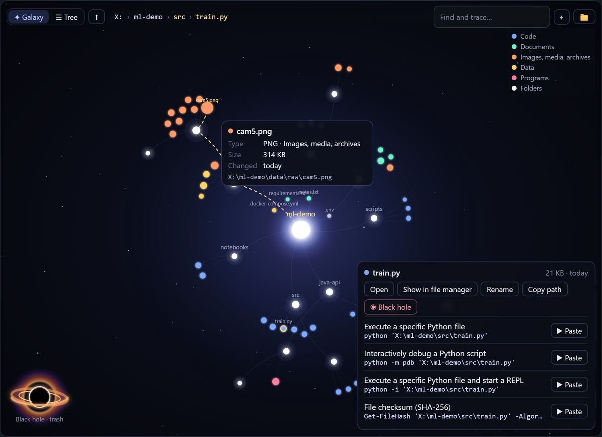
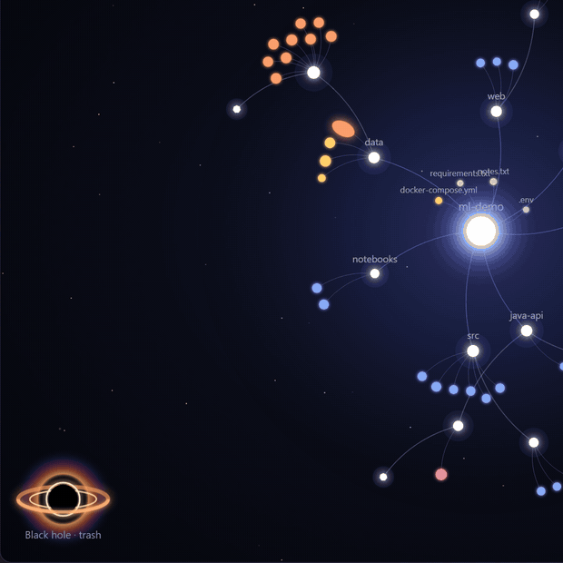
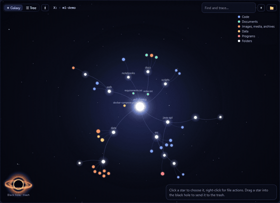
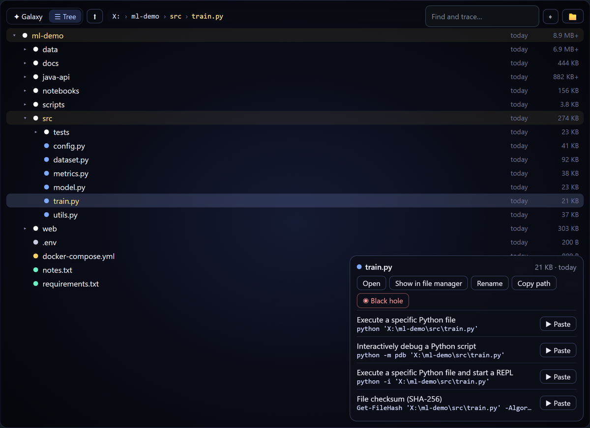

# Cmdex

**A command library that you build as you work — with a builder, an explainer and built-in terminals (local shell, SSH, Telnet, serial/COM). Windows and Linux.**

[English](#english) · [Tiếng Việt](#tiếng-việt)

<p align="center"></p>

---

## English

### What it does

- **Find commands by asking.** Type what you want to do — "show open ports", "restart a service", or in Vietnamese with or without accents — and get the commands of your library ranked from most to least relevant. Commands for the platform of the session you are in come first.
- **Build them.** Every command is a template with `{parameters}`; fill them in and see the final line.
- **Paste them, then run.** ▶ pastes the line into the active terminal — a local shell (PowerShell, bash…), an SSH server, a Telnet device or a serial console — and you press Enter. Commands that change the system are labelled **Warning**, those that may delete data or cut service **Critical**.
- **Network devices too.** Starter commands for **Cisco IOS/IOS-XE** switches and routers and for **pfSense** firewalls. Set a connection's device type and its commands come first; Cisco lines are explained keyword by keyword, abbreviations included (`sh ip int br`, `conf t`).
- **Understand any command.** Paste a command line and Cmdex draws it with every part labelled — program, options, values, operators — with arrows pointing at each part. Combined options like `-ano` or `-tulpn` are split letter by letter. Knowledge comes from your library and from the help already on your computer (`man`, `Get-Help`, `/?`).
- **Collect while you work.** Cmdex reads your shell history and the commands you run through it, **hides passwords and tokens first**, turns values (IPs, hosts, ports, paths, numbers) into parameters, merges lines that differ only in values, classifies them with your rules, and waits for your approval before anything enters the library. Every command counts, `cd`, `dir` and `ls` included: the folders you visit become `{path}`, so `cd Desktop` and `cd D:\Work` are one template. Optionally, commands that resemble one in your library (50, 75, 85 or 100% alike — your choice) are merged into it automatically; new ones always wait for you. The collected log can be cleared at any time or after 7, 30 or 90 days.
- **Your library, your environment.** Two SQLite files on your computer, read as one library:
  - **your database** (`%APPDATA%\Cmdex\cmdex.db`, `~/.config/cmdex/cmdex.db`): the commands you add, collect or change, connections and settings. Updates never touch it. Its sensitive values (connections, your commands, the collected log) are **encrypted**, with a key kept in the system keychain.
  - **the starter commands** (`cmdex-defaults-….db`, next to it): about 100 common Windows and Linux commands with explanations, built from the packs inside the program and refreshed by every update.

  Edit a starter command and it becomes your own copy, which updates leave alone; delete one and it stays deleted (**Restore starter commands** brings it back). Import and export packs as JSON.
- **See your folders as a galaxy.** Work ▸ Map draws the terminal's folder as stars you can hover, fly into and act on; the trash is a black hole. See [Folder map](#folder-map).
- **Keep notes like chat messages.** The bubble in the corner (Ctrl+Shift+N) holds formatted text, tasks, code with colours and images, encrypted in your library; find with match count, pin a note to a file on the map. See [Notes](#notes).
- **English and Vietnamese interface**, five color themes, self-update from GitHub releases (checksum-verified).

### Install

- **Windows 10/11:** download `Cmdex-Windows-Setup-<version>.exe` from [Releases](https://github.com/thangkes/Cmdex/releases). It installs for your user only (no administrator rights).
- **Linux (x86-64):** step by step below.

#### Linux: install the released program

The released program needs **WebKitGTK 4.1**: Ubuntu 22.04+, Debian 12+, Linux Mint 21+, Fedora, Arch, openSUSE, RHEL/Rocky/Alma 10. On RHEL/Rocky/Alma 9 or Ubuntu 20.04 (WebKitGTK 4.0 only), [build from source](#linux-build-from-source) instead.

**1. Libraries** — the one command for your distribution:

| Distribution | Command |
|---|---|
| Ubuntu, Debian, Linux Mint, Pop!_OS | `sudo apt install curl libwebkit2gtk-4.1-0` |
| Fedora, RHEL / Rocky / Alma 10 | `sudo dnf install curl webkit2gtk4.1` |
| Arch, Manjaro, EndeavourOS | `sudo pacman -S --needed curl webkit2gtk-4.1` |
| openSUSE Tumbleweed, Leap 15.6 | `sudo zypper install curl libwebkit2gtk-4_1-0` |

**2. Download, check, install** (no root; the program goes to `~/.local/bin`, with a menu entry):

```bash
VER=$(curl -fsSL https://api.github.com/repos/thangkes/Cmdex/releases/latest | sed -n 's/.*"tag_name": *"v\([^"]*\)".*/\1/p')
mkdir -p ~/cmdex-setup && cd ~/cmdex-setup
curl -fLO "https://github.com/thangkes/Cmdex/releases/download/v$VER/Cmdex-Linux-amd64-$VER.tar.gz"
curl -fLO "https://github.com/thangkes/Cmdex/releases/download/v$VER/SHA256SUMS.txt"
sha256sum -c --ignore-missing SHA256SUMS.txt
tar -xzf "Cmdex-Linux-amd64-$VER.tar.gz"
./install.sh
```

`sha256sum` must print `OK`; stop otherwise. `install.sh` then says which of the next steps your system still needs.

**3. After installing**

- Start Cmdex from the menu, or `cmdex` in a terminal. If the terminal says "command not found", add `~/.local/bin` to your PATH: `echo 'export PATH="$HOME/.local/bin:$PATH"' >> ~/.profile`, then open a new terminal.
- Serial consoles (Cisco console cable, USB-serial): `sudo usermod -aG dialout "$USER"` (Arch: `uucp` instead of `dialout`), then log out and in.
- A password keyring (Secret Service) keeps the key of your encrypted library and your connection passwords: GNOME Keyring is there on GNOME desktops (else install `gnome-keyring`); recent KDE Plasma's KWallet works too. Without one, Cmdex asks for a master password at each start and for connection passwords each time.
- Updates: Cmdex offers them itself; `cmdex --update` installs one at once.

**Uninstall**

```bash
rm -f ~/.local/bin/cmdex ~/.local/share/applications/cmdex.desktop ~/.local/share/icons/hicolor/512x512/apps/cmdex.png
rm -rf ~/.config/cmdex   # your library and settings: only if you want them gone too
```

### Security

- SSH servers are checked against `~/.ssh/known_hosts`. A new server shows its fingerprint before you trust it; a changed key is refused.
- Passwords and key passphrases are stored in the system keychain (Windows Credential Manager, Secret Service on Linux), never in the database.
- Collected commands have secrets masked before they are stored; collecting can be turned off per source.
- Help lookup never runs an unknown program: it reads `man` pages, PowerShell `Get-Help`, and `/?` only for Windows' own tools in System32.
- Updates are downloaded from this repository's releases and installed only when their SHA-256 matches the published `SHA256SUMS.txt`.
- JSON backups can be encrypted with a password of your choice, or kept plain; see [Moving to another computer](#moving-to-another-computer). Details in [SECURITY.md](SECURITY.md).

### Build from source

Windows (Go 1.27+; the installer needs Inno Setup 6):

```sh
go test ./...
./scripts/build-windows.ps1
```

<a id="linux-build-from-source"></a>
#### Linux: build from source

One script does every step below (it asks for `sudo` only to install the libraries):

```bash
git clone https://github.com/thangkes/Cmdex.git && cd Cmdex
./scripts/build-linux.sh                 # --no-deps, --no-test, --no-install to skip steps
```

By hand, step by step:

**1. Libraries.** Wails (the window) is built with cgo against GTK 3 and WebKitGTK, so it needs a C compiler, `pkg-config` and their development files:

| Distribution | Command |
|---|---|
| Ubuntu 22.04+, Debian 12+, Mint 21+ | `sudo apt install build-essential pkg-config curl libgtk-3-dev libwebkit2gtk-4.1-dev` |
| Ubuntu 20.04, Debian 11 | same, with `libwebkit2gtk-4.0-dev` |
| Fedora, RHEL / Rocky / Alma 10 | `sudo dnf install gcc pkgconf-pkg-config curl tar gzip 'pkgconfig(gtk+-3.0)' 'pkgconfig(webkit2gtk-4.1)'` |
| RHEL / Rocky / Alma 9 | `sudo dnf config-manager --set-enabled crb`, then the line above with `'pkgconfig(webkit2gtk-4.0)'` |
| Arch, Manjaro, EndeavourOS | `sudo pacman -S --needed base-devel pkgconf curl gtk3 webkit2gtk-4.1` |
| openSUSE Tumbleweed, Leap 15.6 | `sudo zypper install gcc pkg-config curl tar gzip 'pkgconfig(gtk+-3.0)' 'pkgconfig(webkit2gtk-4.1)'` |

The other Go libraries need nothing from the system to build: SSH, Telnet, serial ports, terminals and SQLite are pure Go. At run time the password keyring and the `dialout` group matter (see "After installing" above).

**2. Go**, the version in `go.mod` (distribution packages are often older), into your home folder, with its checksum checked:

```bash
GOV=$(sed -n 's/^go //p' go.mod)
curl -fLO "https://dl.google.com/go/go$GOV.linux-amd64.tar.gz"
echo "$(curl -fsSL "https://dl.google.com/go/go$GOV.linux-amd64.tar.gz.sha256")  go$GOV.linux-amd64.tar.gz" | sha256sum -c -
mkdir -p ~/.local/go-$GOV && tar -C ~/.local/go-$GOV --strip-components=1 -xzf go$GOV.linux-amd64.tar.gz
export PATH="$HOME/.local/go-$GOV/bin:$PATH" GOTOOLCHAIN=local
go version
```

**3. Go modules**, downloaded and checked against `go.sum`:

```bash
go mod download
go mod verify
```

**4. Test and build:**

```bash
go test ./...
go build -tags desktop,production,webkit2_41 -trimpath -buildvcs=false \
  -ldflags "-w -s -X github.com/thangkes/cmdex/internal/app.Version=$(cat VERSION)" -o dist/cmdex .
```

With WebKitGTK 4.0 (RHEL 9, Ubuntu 20.04): drop `,webkit2_41`, and add `-X github.com/thangkes/cmdex/internal/app.Updates=off` to the `-ldflags`. Released programs need 4.1, so such a build must not update itself; it updates by building again.

**5. Install** (as the released program: `~/.local/bin` and a menu entry):

```bash
cp build/appicon.png dist/cmdex.png
cp packaging/linux/cmdex.desktop packaging/linux/install.sh dist/
sh dist/install.sh
```

For interface work without the desktop shell: `CMDEX_DB=./tmp/cmdex.db go run ./tools/devserve`, then open http://127.0.0.1:34115.

### Moving to another computer

**Library ▸ Export…** saves a full backup (`.json`: commands, explanations, rules, synonyms, connections, collected lines, notes and their images, settings — never passwords) or a copy of the database file (`.db`). **Library ▸ Import…** loads either one, merging into your library or replacing it.

**With or without a password: you choose** (since 0.2.1). A full backup asks how to keep it:

- **With a password** (at least 8 characters, typed twice on the secure keypad), the backup is encrypted (AES-256-GCM, key from the password with Argon2id). It opens on any Windows or Linux computer, but only with that password; a forgotten password cannot be recovered. Import asks for it and lets you try again.
- **Without one**, it is plain JSON that anything can read (the file is readable by your account only): keep it as safe as the library itself.

A `.db` copy stays encrypted with this computer's key, so it imports only on the computer that made it; use a JSON backup to move.

From a terminal:

```
cmdex --export backup.json              # plain JSON
cmdex --export backup.json --password   # encrypted: the password is asked twice
cmdex --import backup.json [--replace]  # asks for the password if the file has one
```

Passwords are always asked, never given on the command line. The file format is described in [docs/backup-format.md](docs/backup-format.md).

### Folder map

**Work ▸ Map** draws the terminal's folder as a galaxy: the folder is the bright core, sub-folders are white stars, files are coloured dots (code, documents, media, data, programs).

- **Hover** a star for its type, size, date and path; the path from the core lights up. No need to aim: the nearest star is picked. **Find** traces a file by name.
- **Click a folder** to fly to it, and click again to make it the new core. Four layers are read at a time, so large drives stay light.
- **File actions** (right-click): open, show in the file manager, rename, new folder, copy the path.
- **Several at once**: Ctrl+click adds a star, Shift+drag chooses every star in a box; throw the whole group into the black hole with one confirmation.
- The map **opens where you left it**: the folder shown last is remembered (encrypted).
- **The black hole is the trash.** Drag a star into it and the file is stretched into a strand that winds into the hole, while it goes to the system trash (restorable). Deleting never bypasses the trash.
- **Commands for a file** come from your library (`python …`, `java -jar …`, `mvn package` for a `pom.xml`) and are pasted into the terminal.
- **Tree** arranges the same stars as branches, from the core on the left to the third layer on the right; switching between the two views morphs one into the other.

| The black hole | Galaxy ⇄ branches |
|---|---|
|  |  |

<p align="center"></p>

### Notes

The chat bubble in the corner (Ctrl+Shift+N) keeps notes like messages: text in any language with **bold**, *italic*, __underline__, ~~strike~~, ==highlight==, colours, headings, lists, tasks you can tick, quotes and code blocks, plus images you paste or drop. Commands and scripts in a note are coloured (PowerShell, bash, cmd, Python, JavaScript, Go, SQL, JSON, YAML…) and can only be copied, never run from there. **Find** marks every match, shows how many there are and steps through them with the arrows (accents and case ignored). A note can be pinned to the file or folder chosen on the map. Notes and their images are encrypted in your database and travel in backups.

**Terminal copy and paste**: right-click in a terminal to copy the selection or everything it holds, paste, select all or clear the screen. Ctrl+C copies when text is selected and interrupts otherwise; pasting several lines asks first.

### Packs

A pack is a JSON file of commands, explanations, synonyms and rules; texts may be plain strings or `{"en": "…", "vi": "…"}`. See [`packs/`](packs) for the starter packs. Library ▸ Import / Export moves your library between computers.

**Tool packs** (Library ▸ Tool packs) hold commands for programs such as nmap or python. They are built into Cmdex, so nothing is downloaded. Cmdex offers one when it finds its program on `PATH`; it only looks at file names and never runs the program. Turning a pack off removes its commands, but the ones you edited stay. See [`packs/tools/`](packs/tools) for the format and the tldr-pages converter. The Python, Java, Maven and Gradle packs are adapted from [tldr-pages](https://github.com/tldr-pages/tldr) ([CC BY 4.0](https://creativecommons.org/licenses/by/4.0/)), with a Vietnamese translation added. The Nmap pack is written from Nmap's own help: common scans with every option explained; loud, intrusive or spoofing scans carry a **Warning** label (dos scripts **Critical**), and nothing is blocked.

License: [MIT](LICENSE).

---

## Tiếng Việt

### Cmdex làm gì

- **Tìm lệnh bằng cách hỏi.** Gõ việc cần làm — "xem cổng đang mở", "khởi động lại dịch vụ", có dấu hay không dấu đều được — Cmdex liệt kê lệnh trong thư viện từ liên quan nhất đến ít nhất, ưu tiên lệnh hợp với phiên đang mở.
- **Dựng lệnh.** Mỗi lệnh là một mẫu có `{tham số}`; điền vào là thấy ngay dòng lệnh hoàn chỉnh.
- **Dán rồi mới chạy.** Nút ▶ dán lệnh vào terminal đang chọn — shell trên máy (PowerShell, bash…), máy chủ SSH, thiết bị Telnet hay cổng COM — và bạn tự nhấn Enter. Lệnh thay đổi hệ thống có nhãn **Cảnh báo**, lệnh có thể xóa dữ liệu hoặc ngắt dịch vụ có nhãn **Critical**.
- **Cả thiết bị mạng.** Có sẵn lệnh cho switch/router **Cisco IOS/IOS-XE** và tường lửa **pfSense**. Chọn loại thiết bị cho kết nối thì lệnh của thiết bị đó lên đầu; lệnh Cisco được giải nghĩa từng từ khóa, kể cả viết tắt (`sh ip int br`, `conf t`).
- **Hiểu mọi dòng lệnh.** Dán một lệnh vào, Cmdex vẽ lệnh đó với từng phần được ghi chú — chương trình, tùy chọn, giá trị, toán tử — có mũi tên chỉ vào đúng chỗ. Tùy chọn ghép như `-ano`, `-tulpn` được tách từng chữ. Giải nghĩa lấy từ thư viện của bạn và từ trợ giúp có sẵn trên máy (`man`, `Get-Help`, `/?`).
- **Tự thu thập khi bạn làm việc.** Cmdex đọc lịch sử shell và các lệnh chạy qua nó, **che mật khẩu/token trước tiên**, đổi giá trị (IP, tên máy, cổng, đường dẫn, số) thành tham số, gộp những dòng chỉ khác giá trị, phân loại theo quy tắc của bạn, và chờ bạn duyệt rồi mới đưa vào thư viện. Mọi lệnh đều được thu thập, kể cả `cd`, `dir`, `ls`: thư mục bạn vào được đổi thành `{path}`, nên `cd Desktop` và `cd D:\Work` gộp chung một mẫu. Có thể bật tự gộp: lệnh giống một lệnh trong thư viện từ mức bạn chọn (50, 75, 85 hoặc 100%) được gộp luôn vào lệnh đó; lệnh mới vẫn luôn chờ bạn duyệt. Nhật ký thu thập xoá được bất cứ lúc nào, hoặc tự xoá sau 7, 30, 90 ngày.
- **Thư viện của bạn, theo môi trường của bạn.** Hai file SQLite trên máy, được đọc gộp thành một thư viện:
  - **database của bạn** (`%APPDATA%\Cmdex\cmdex.db`, `~/.config/cmdex/cmdex.db`): lệnh bạn thêm, thu thập hay sửa, kết nối và cài đặt. Cập nhật không bao giờ đụng vào. Dữ liệu nhạy cảm trong đó (kết nối, lệnh của bạn, nhật ký thu thập) được **mã hóa**, khóa nằm trong kho bảo mật của hệ điều hành.
  - **lệnh mẫu** (`cmdex-defaults-….db`, nằm cạnh file trên): khoảng 100 lệnh Windows và Linux thông dụng kèm giải nghĩa, dựng từ các gói lệnh có sẵn trong chương trình và được làm mới mỗi lần cập nhật.

  Sửa một lệnh mẫu thì nó thành bản của riêng bạn, các bản cập nhật không đè lên; xoá thì nó không tự quay lại (nút **Khôi phục lệnh mẫu** đưa lại). Nhập/xuất gói lệnh dạng JSON.
- **Thư mục thành thiên hà.** Làm việc ▸ Bản đồ vẽ thư mục của terminal thành các vì sao để rê chuột, bay vào và thao tác; thùng rác là một hố đen. Xem [Bản đồ thư mục](#bản-đồ-thư-mục).
- **Ghi chú như nhắn tin.** Bong bóng chat ở góc (Ctrl+Shift+N) lưu chữ có định dạng, việc cần làm, code tô màu và ảnh, được mã hoá trong thư viện; tìm có đếm số kết quả, gắn ghi chú với file trên bản đồ. Xem [Ghi chú](#ghi-chú).
- **Giao diện tiếng Việt và tiếng Anh**, 5 theme màu, tự cập nhật từ GitHub (có kiểm tra mã băm).

### Cài đặt

- **Windows 10/11:** tải `Cmdex-Windows-Setup-<phiên bản>.exe` ở [Releases](https://github.com/thangkes/Cmdex/releases). Cài cho riêng tài khoản của bạn, không cần quyền Administrator.
- **Linux (x86-64):** làm theo từng bước dưới đây.

#### Linux: cài bản phát hành

Bản phát hành cần **WebKitGTK 4.1**: Ubuntu 22.04+, Debian 12+, Linux Mint 21+, Fedora, Arch, openSUSE, RHEL/Rocky/Alma 10. Với RHEL/Rocky/Alma 9 hoặc Ubuntu 20.04 (chỉ có WebKitGTK 4.0), hãy [build từ mã nguồn](#linux-build-tu-ma-nguon).

**1. Thư viện** — chạy đúng một lệnh theo distro của bạn:

| Distro | Lệnh |
|---|---|
| Ubuntu, Debian, Linux Mint, Pop!_OS | `sudo apt install curl libwebkit2gtk-4.1-0` |
| Fedora, RHEL / Rocky / Alma 10 | `sudo dnf install curl webkit2gtk4.1` |
| Arch, Manjaro, EndeavourOS | `sudo pacman -S --needed curl webkit2gtk-4.1` |
| openSUSE Tumbleweed, Leap 15.6 | `sudo zypper install curl libwebkit2gtk-4_1-0` |

**2. Tải, kiểm tra, cài** (không cần root; chương trình nằm ở `~/.local/bin`, có thêm vào menu):

```bash
VER=$(curl -fsSL https://api.github.com/repos/thangkes/Cmdex/releases/latest | sed -n 's/.*"tag_name": *"v\([^"]*\)".*/\1/p')
mkdir -p ~/cmdex-setup && cd ~/cmdex-setup
curl -fLO "https://github.com/thangkes/Cmdex/releases/download/v$VER/Cmdex-Linux-amd64-$VER.tar.gz"
curl -fLO "https://github.com/thangkes/Cmdex/releases/download/v$VER/SHA256SUMS.txt"
sha256sum -c --ignore-missing SHA256SUMS.txt
tar -xzf "Cmdex-Linux-amd64-$VER.tar.gz"
./install.sh
```

`sha256sum` phải in ra `OK`; nếu không thì dừng lại. Sau đó `install.sh` sẽ báo máy bạn còn thiếu bước nào bên dưới.

**3. Sau khi cài**

- Mở Cmdex từ menu, hoặc gõ `cmdex` trong terminal. Nếu báo "command not found", thêm `~/.local/bin` vào PATH: `echo 'export PATH="$HOME/.local/bin:$PATH"' >> ~/.profile`, rồi mở terminal mới.
- Cổng COM (cáp console Cisco, USB-serial): `sudo usermod -aG dialout "$USER"` (Arch dùng `uucp` thay cho `dialout`), rồi đăng xuất và đăng nhập lại.
- Kho mật khẩu (Secret Service) giữ khóa của thư viện đã mã hóa và mật khẩu kết nối: desktop GNOME có sẵn GNOME Keyring (nếu không thì cài gói `gnome-keyring`); KWallet của KDE Plasma bản mới cũng dùng được. Không có thì Cmdex hỏi mật khẩu chính mỗi lần mở, và hỏi mật khẩu kết nối mỗi lần dùng.
- Cập nhật: Cmdex tự báo khi có bản mới; `cmdex --update` để cài ngay.

**Gỡ cài đặt**

```bash
rm -f ~/.local/bin/cmdex ~/.local/share/applications/cmdex.desktop ~/.local/share/icons/hicolor/512x512/apps/cmdex.png
rm -rf ~/.config/cmdex   # thư viện và cài đặt của bạn: chỉ xóa khi muốn bỏ luôn
```

<a id="linux-build-tu-ma-nguon"></a>
#### Linux: build từ mã nguồn

Một script làm hết các bước bên dưới (chỉ hỏi `sudo` khi cài thư viện):

```bash
git clone https://github.com/thangkes/Cmdex.git && cd Cmdex
./scripts/build-linux.sh                 # --no-deps, --no-test, --no-install để bỏ bớt bước
```

Làm tay từng bước:

**1. Thư viện.** Wails (phần cửa sổ) build bằng cgo với GTK 3 và WebKitGTK, nên cần trình biên dịch C, `pkg-config` và gói phát triển của chúng:

| Distro | Lệnh |
|---|---|
| Ubuntu 22.04+, Debian 12+, Mint 21+ | `sudo apt install build-essential pkg-config curl libgtk-3-dev libwebkit2gtk-4.1-dev` |
| Ubuntu 20.04, Debian 11 | như trên, thay bằng `libwebkit2gtk-4.0-dev` |
| Fedora, RHEL / Rocky / Alma 10 | `sudo dnf install gcc pkgconf-pkg-config curl tar gzip 'pkgconfig(gtk+-3.0)' 'pkgconfig(webkit2gtk-4.1)'` |
| RHEL / Rocky / Alma 9 | `sudo dnf config-manager --set-enabled crb`, rồi lệnh như trên với `'pkgconfig(webkit2gtk-4.0)'` |
| Arch, Manjaro, EndeavourOS | `sudo pacman -S --needed base-devel pkgconf curl gtk3 webkit2gtk-4.1` |
| openSUSE Tumbleweed, Leap 15.6 | `sudo zypper install gcc pkg-config curl tar gzip 'pkgconfig(gtk+-3.0)' 'pkgconfig(webkit2gtk-4.1)'` |

Các thư viện Go còn lại không cần gì từ hệ thống khi build: SSH, Telnet, cổng COM, terminal và SQLite đều viết bằng Go thuần. Lúc chạy thì cần kho mật khẩu và nhóm `dialout` (xem "Sau khi cài" ở trên).

**2. Go** đúng phiên bản ghi trong `go.mod` (gói Go của distro thường cũ hơn), cài vào thư mục home, có kiểm tra checksum:

```bash
GOV=$(sed -n 's/^go //p' go.mod)
curl -fLO "https://dl.google.com/go/go$GOV.linux-amd64.tar.gz"
echo "$(curl -fsSL "https://dl.google.com/go/go$GOV.linux-amd64.tar.gz.sha256")  go$GOV.linux-amd64.tar.gz" | sha256sum -c -
mkdir -p ~/.local/go-$GOV && tar -C ~/.local/go-$GOV --strip-components=1 -xzf go$GOV.linux-amd64.tar.gz
export PATH="$HOME/.local/go-$GOV/bin:$PATH" GOTOOLCHAIN=local
go version
```

**3. Module Go**: tải về và đối chiếu với `go.sum`:

```bash
go mod download
go mod verify
```

**4. Test và build:**

```bash
go test ./...
go build -tags desktop,production,webkit2_41 -trimpath -buildvcs=false \
  -ldflags "-w -s -X github.com/thangkes/cmdex/internal/app.Version=$(cat VERSION)" -o dist/cmdex .
```

Với WebKitGTK 4.0 (RHEL 9, Ubuntu 20.04): bỏ `,webkit2_41` và thêm `-X github.com/thangkes/cmdex/internal/app.Updates=off` vào `-ldflags`. Bản phát hành cần 4.1, nên bản build này không được tự cập nhật; muốn cập nhật thì build lại.

**5. Cài** (giống bản phát hành: `~/.local/bin` và thêm vào menu):

```bash
cp build/appicon.png dist/cmdex.png
cp packaging/linux/cmdex.desktop packaging/linux/install.sh dist/
sh dist/install.sh
```

### Bảo mật

- Máy chủ SSH được đối chiếu với `~/.ssh/known_hosts`. Máy chủ mới hiện vân tay để bạn xác nhận; khóa bị thay đổi thì Cmdex từ chối kết nối.
- Mật khẩu và passphrase lưu trong kho bảo mật của hệ điều hành (Windows Credential Manager, Secret Service trên Linux), không bao giờ nằm trong database.
- Lệnh thu thập được che bí mật trước khi lưu; tắt được từng nguồn thu thập.
- Tra trợ giúp không bao giờ chạy chương trình lạ: chỉ đọc `man`, `Get-Help` của PowerShell, và `/?` với công cụ hệ thống của Windows trong System32.
- Bản cập nhật tải từ Releases của repo này và chỉ được cài khi mã SHA-256 khớp với `SHA256SUMS.txt` đã công bố.
- Bản sao lưu JSON có thể mã hoá bằng mật khẩu bạn đặt, hoặc để dạng thường; xem [Chuyển sang máy khác](#chuyển-sang-máy-khác). Chi tiết trong [SECURITY.md](SECURITY.md).

### Chuyển sang máy khác

**Thư viện lệnh ▸ Xuất…** lưu bản sao lưu đầy đủ (`.json`: lệnh, giải nghĩa, quy tắc, từ đồng nghĩa, kết nối, lệnh thu thập, ghi chú kèm ảnh, cài đặt — không bao giờ có mật khẩu) hoặc bản chép file database (`.db`). **Thư viện lệnh ▸ Nhập…** nạp lại một trong hai, chọn gộp hoặc thay thế toàn bộ.

**Có hay không mật khẩu: bạn chọn** (từ 0.2.1). Khi sao lưu đầy đủ, Cmdex hỏi bạn muốn giữ file thế nào:

- **Có mật khẩu** (ít nhất 8 ký tự, gõ hai lần trên bàn phím bảo mật): bản sao lưu được mã hoá (AES-256-GCM, khoá sinh từ mật khẩu bằng Argon2id). Mở được trên mọi máy Windows hay Linux, nhưng chỉ khi có đúng mật khẩu; quên mật khẩu thì không khôi phục được. Lúc nhập, Cmdex hỏi mật khẩu và cho nhập lại nếu sai.
- **Không mật khẩu**: file JSON thường, ai mở cũng đọc được (file chỉ tài khoản của bạn đọc được): hãy giữ nó cẩn thận như chính thư viện.

Bản chép `.db` vẫn mã hoá bằng khoá của máy này nên chỉ nhập lại được trên chính máy đã tạo ra nó; muốn chuyển máy thì dùng bản sao lưu JSON.

Dùng dòng lệnh:

```
cmdex --export backup.json              # JSON thường
cmdex --export backup.json --password   # mã hoá: hỏi mật khẩu hai lần
cmdex --import backup.json [--replace]  # tự hỏi mật khẩu nếu file có đặt
```

Mật khẩu luôn được hỏi, không bao giờ ghi trên dòng lệnh. Cấu trúc file mô tả trong [docs/backup-format.md](docs/backup-format.md).

### Bản đồ thư mục

**Làm việc ▸ Bản đồ** vẽ thư mục của terminal thành một thiên hà: thư mục là lõi sáng, thư mục con là sao trắng, file là các chấm màu (code, tài liệu, ảnh/video, dữ liệu, chương trình).

- **Rê chuột** vào ngôi sao để xem loại, dung lượng, ngày sửa và đường dẫn; đường đi từ lõi sẽ sáng lên. Không cần trỏ trúng, Cmdex tự bắt ngôi sao gần nhất. Ô **Tìm** giúp truy vết file theo tên.
- **Bấm thư mục** để bay tới, bấm lần nữa để nó thành lõi mới. Mỗi lần chỉ đọc 4 lớp nên ổ lớn vẫn nhẹ.
- **Thao tác file** (chuột phải): mở, hiện trong Explorer, đổi tên, tạo thư mục, chép đường dẫn.
- **Nhiều file cùng lúc**: Ctrl+bấm để thêm từng ngôi sao, Shift+kéo để chọn mọi sao trong khung; ném cả nhóm vào hố đen chỉ với một lần xác nhận.
- Bản đồ **mở lại đúng chỗ bạn đang làm**: thư mục xem lần cuối được nhớ (mã hoá).
- **Hố đen là Thùng rác.** Kéo ngôi sao thả vào hố đen: file bị kéo thành sợi xoắn vào hố đen, còn thực tế là vào Thùng rác của hệ điều hành (khôi phục được). Không bao giờ xoá vĩnh viễn.
- **Lệnh cho file** lấy từ thư viện (`python …`, `java -jar …`, `mvn package` cho `pom.xml`) và được dán vào terminal.
- **Cây thư mục** xếp chính các ngôi sao đó thành nhánh, từ lõi bên trái sang lớp thứ ba bên phải; chuyển qua lại giữa hai chế độ có hiệu ứng thiên hà duỗi thành nhánh và cuộn lại.

| Hố đen | Ngân hà ⇄ nhánh |
|---|---|
|  |  |

<p align="center"></p>

### Ghi chú

Bong bóng chat ở góc (Ctrl+Shift+N) lưu ghi chú như tin nhắn: chữ ngôn ngữ nào cũng được, có **đậm**, *nghiêng*, __gạch chân__, ~~gạch ngang~~, ==tô sáng==, chữ màu, tiêu đề, danh sách, việc cần làm tick được, trích dẫn và khối code, cùng ảnh dán hoặc kéo thả vào. Lệnh và script trong ghi chú được tô màu (PowerShell, bash, cmd, Python, JavaScript, Go, SQL, JSON, YAML…) và chỉ sao chép được, không bao giờ chạy từ đó. Ô **Tìm** tô sáng mọi chỗ khớp, hiện số kết quả và dùng mũi tên để rà lần lượt (không phân biệt dấu và hoa thường). Ghi chú có thể gắn với file hay thư mục đang chọn trên bản đồ. Ghi chú và ảnh được mã hoá trong database của bạn và có trong bản sao lưu.

**Sao chép và dán trong terminal**: chuột phải trong terminal để sao chép đoạn đang chọn hoặc toàn bộ nội dung, dán, chọn tất cả hoặc xoá màn hình. Ctrl+C sao chép khi đang bôi đen và ngắt lệnh khi không; dán nhiều dòng sẽ được hỏi lại trước.

### Gói công cụ

**Thư viện lệnh ▸ Gói công cụ** chứa lệnh cho các chương trình như nmap, python. Các gói có sẵn trong Cmdex nên không tải gì về. Cmdex gợi ý một gói khi thấy chương trình đó trong `PATH`. Nó chỉ xem tên file, không chạy chương trình. Tắt gói sẽ bỏ các lệnh của gói, nhưng lệnh bạn đã sửa vẫn được giữ. Định dạng gói và công cụ chuyển từ tldr-pages xem ở [`packs/tools/`](packs/tools). Các gói Python, Java, Maven, Gradle được chuyển thể từ [tldr-pages](https://github.com/tldr-pages/tldr) ([CC BY 4.0](https://creativecommons.org/licenses/by/4.0/)) và dịch thêm tiếng Việt. Gói Nmap được viết dựa trên phần trợ giúp của chính Nmap: các kiểu quét hay dùng, giải nghĩa từng tuỳ chọn; kiểu quét ồn, có tính xâm nhập hoặc giả mạo được gắn nhãn **Warning** (script dos là **Critical**), không lệnh nào bị chặn.

Giấy phép: [MIT](LICENSE).
